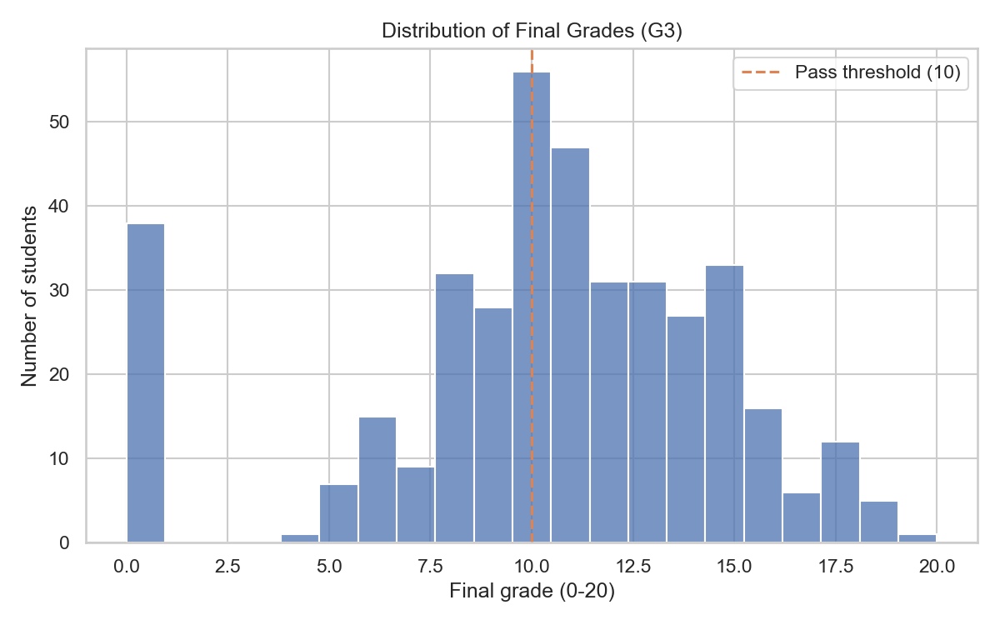
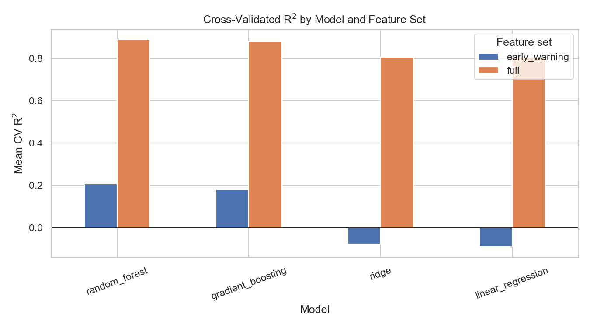
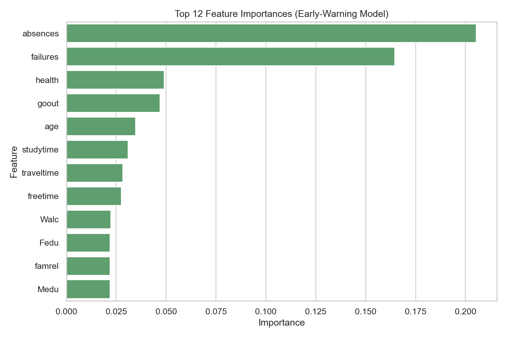

# Student Performance Predictor

A machine learning project that predicts a student's final math grade (0–20) from demographic, family, and behavioral data, with the goal of flagging at-risk students **before any grades exist** so teachers can intervene early. Built on the UCI [Student Performance](https://archive.ics.uci.edu/dataset/320/student+performance) dataset, the project covers the full pipeline — EDA, preprocessing, model comparison, evaluation, and a Streamlit app for interactive predictions.

## Key results

Two feature sets were compared to understand how much predictive signal comes from prior grades versus demographic/behavioral data alone. All models were evaluated on a held-out 20% test set after 5-fold cross-validated model selection.

| Feature set | Best model | R² | RMSE | MAE | Pass/fail accuracy |
|---|---|---|---|---|---|
| **Early-warning** (no grade history) | Random Forest | 0.30 | 3.78 | 3.01 | 67.1% |
| Full (includes G1, G2 period grades) | Random Forest | 0.80 | 2.01 | 1.19 | 89.9% |

The **early-warning model** is the one deployed in the app — it only beats a naive "always predict pass" baseline (65.8% accuracy on this test set) by a small margin on the pass/fail metric, but its R² of 0.30 shows it does capture real signal in *how far* a student is from passing, which is useful as a soft screening score rather than a hard verdict. See [REPORT.md](REPORT.md) for the full analysis and discussion of this trade-off.

## Figures

**Final grade distribution** — most students cluster around a passing grade, with a wider failing tail (full width: [reports/figures/01_grade_distribution.png](reports/figures/01_grade_distribution.png)).



**Model comparison** — including prior period grades (G1, G2) lifts R² from ~0.2 to ~0.9 across every model, showing how much of the final grade is already determined by mid-term performance.



**Feature importance (early-warning model)** — absences and past failures dominate, both of which are actionable signals a school can monitor from day one.



More figures (correlation heatmap, absences vs. pass rate, study time vs. grade, predicted vs. actual) are in [reports/figures/](reports/figures/).

## App

`app/app.py` is a Streamlit app that collects a student's profile through a form — school, family background, study habits, support systems, and lifestyle factors — and returns a predicted final grade plus a pass/at-risk flag, styled as a quick screening tool for teachers or counselors.

```
🎓 Student Performance Predictor
┌─────────────────────────────────────────────────┐
│ Student profile                                  │
│  School, sex, age, address, family size, ...     │
│  Mother/father education & job, study time, ...   │
│  Support & lifestyle: tutoring, internet, ...     │
├─────────────────────────────────────────────────┤
│ [ Predict final grade ]                          │
├─────────────────────────────────────────────────┤
│ Predicted final grade (G3): 10.8 / 20            │
│ Predicted outcome: Pass                          │
│ ▓▓▓▓▓▓▓▓▓▓▓▓▓▓▓▓▓▓▓▓▓▓▓▓▓░░░░░░░░░░              │
└─────────────────────────────────────────────────┘
```

Run it locally with `streamlit run app/app.py` (see [Setup and run](#setup-and-run) below).

## Project structure

```
student-performance-predictor/
├── README.md
├── REPORT.md
├── PLAN.md
├── LICENSE
├── requirements.txt
├── data/
│   ├── raw/                 # original UCI CSV files
│   └── processed/           # cleaned dataset
├── notebooks/
│   └── 01_student_performance.ipynb   # EDA -> modeling -> evaluation
├── src/
│   ├── data.py               # dataset loading
│   ├── preprocess.py         # cleaning, feature sets, preprocessing pipeline
│   ├── train.py               # model comparison, selection, training
│   └── evaluate.py           # metrics, predictions, feature importance
├── models/                   # saved best model (joblib) + metadata
├── reports/
│   └── figures/              # all plots used in README/REPORT
├── app/
│   └── app.py                 # Streamlit app
└── tests/
    └── test_pipeline.py       # data loads, pipeline fits, model predicts
```

## Setup and run

Requires Python 3.10+.

```bash
# Clone and enter the project
git clone <this-repo-url>
cd student-performance-predictor

# Create and activate a virtual environment
python -m venv venv
source venv/bin/activate        # Windows: venv\Scripts\activate

# Install dependencies
pip install -r requirements.txt
```

**Run the notebook** (EDA, modeling, evaluation):

```bash
jupyter notebook notebooks/01_student_performance.ipynb
```

**Retrain the model from the command line:**

```bash
python -m src.preprocess                       # clean data -> data/processed/
python -m src.train --feature-set early_warning # train + save models/best_model.joblib
```

**Run the app:**

```bash
streamlit run app/app.py
```

**Run the tests:**

```bash
pytest tests/
```

## Tech stack

- **Python** — pandas, NumPy for data handling
- **scikit-learn** — preprocessing pipelines, Linear/Ridge Regression, Random Forest, Gradient Boosting
- **matplotlib, seaborn** — visualization
- **Streamlit** — interactive web app
- **Jupyter** — exploratory analysis and reporting
- **pytest** — pipeline smoke tests

## Dataset

[UCI Machine Learning Repository: Student Performance Data Set](https://archive.ics.uci.edu/dataset/320/student+performance) (Math course subset, `student-mat.csv`, 395 students, 33 attributes).

> P. Cortez and A. Silva. Using Data Mining to Predict Secondary School Student Performance. In A. Brito and J. Teixeira Eds., *Proceedings of 5th FUture BUsiness TEChnology Conference (FUBUTEC 2008)* pp. 5-12, Porto, Portugal, April, 2008, EUROSIS, ISBN 978-9077381-39-7.

## Limitations

- **Small dataset**: 395 students from two Portuguese schools — results may not generalize to other schools, regions, or grading systems.
- **Modest early-warning accuracy**: without grade history, the model's R² (0.30) is moderate and its pass/fail accuracy barely beats a naive "always predict pass" baseline. It should be treated as a soft screening signal, not a diagnostic tool, and should never be the sole basis for a decision about a student.
- **No causal claims**: feature importance reflects correlation (e.g., absences, failures), not causation — intervening on these features directly may not change outcomes the way the model's associations might suggest.
- **Self-reported survey features** (alcohol consumption, family relationship quality, etc.) are subject to reporting bias.
- **Single subject**: trained only on the Math course dataset; performance on the Portuguese course dataset (also included in `data/raw/`) was not evaluated.

## License

Released under the [MIT License](LICENSE).
