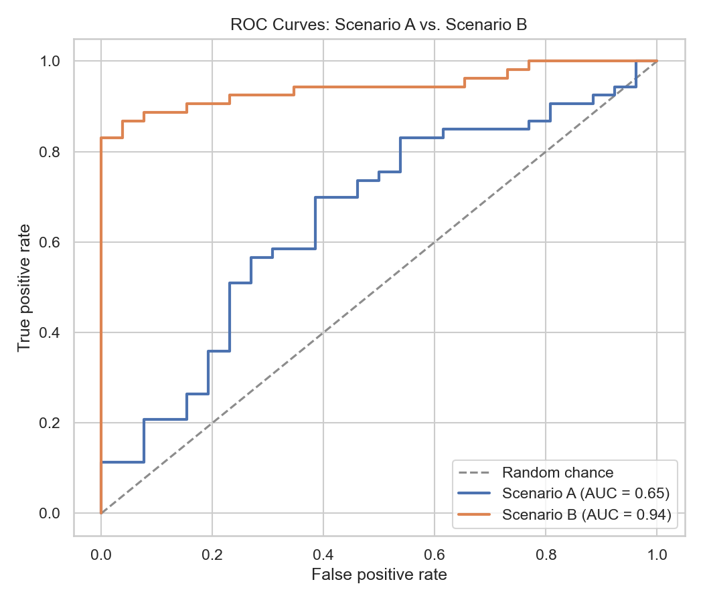

# Student Performance Predictor

A machine learning project that screens for academic risk using demographic, family, and behavioral data, with the goal of flagging at-risk students **before any grades exist** so teachers can intervene early. Built on the UCI [Student Performance](https://archive.ics.uci.edu/dataset/320/student+performance) dataset, the project covers the full pipeline — EDA, preprocessing, model comparison (both regression and direct classification), SHAP-based explainability, evaluation, and a multipage Streamlit web app for interactive predictions.

## Key results

Two scenarios were compared to understand how much predictive signal comes from prior grades versus demographic/behavioral data alone, modeled both as regression (predicting the 0-20 final grade) and as direct binary classification (pass/fail). All models were evaluated on a held-out 20% test set after 5-fold cross-validated model selection.

**Classification — deployed in the app**

| Scenario | Best model | Accuracy | Recall (fail class) | ROC-AUC |
|---|---|---|---|---|
| **A — Early-warning** (no grade history) | Random Forest | 69.6% | 46.2% | 0.65 |
| B — Full (includes G1, G2 period grades) | Gradient Boosting | 88.6% | 92.3% | 0.94 |

**Regression**

| Scenario | Best model | R² | RMSE | MAE |
|---|---|---|---|---|
| **A — Early-warning** | Random Forest | 0.30 | 3.78 | 3.01 |
| B — Full (+ G1, G2) | Random Forest | 0.80 | 2.01 | 1.19 |

**Scenario A is what's deployed** — it only catches about 46% of students who will actually fail (recall on the fail class), even with class-balanced training. Scenario B's much stronger numbers come from G1/G2 already containing most of the answer, which makes it accurate but useless as an *early* warning — by the time those grades exist, a third of the term has already happened. See [REPORT.md](REPORT.md) for the full analysis of this trade-off (the "leakage decision").

## Figures

**Final grade distribution** — most students cluster around a passing grade, with a wider failing tail.


**ROC curves** — Scenario A (deployed) vs. Scenario B (comparison only), showing how much discrimination ability comes from prior grades.



**Feature importance (Scenario A)** — absences and past failures dominate, both of which are actionable signals a school can monitor from day one.


More figures (correlation heatmap, absences vs. pass rate, study time vs. grade, predicted vs. actual, confusion matrices) are in [reports/figures/](reports/figures/).

## Web app

A multipage Streamlit app (`app/`) turns the model into an actual tool rather than a notebook cell:

- **Home** — project overview with animated stat cards (students analyzed, model accuracy, recall on the fail class, feature count).
- **Predictor** — the main tool: a grouped form (School, Academic, Family, Lifestyle) feeds a probability gauge, a PASS / AT-RISK badge, and a SHAP-based "why this prediction" chart with plain-language suggested focus areas.
- **Insights** — an interactive, filterable Plotly dashboard of the EDA findings (by sex, school, study time).
- **Model Performance** — cross-validation leaderboards, ROC curves, confusion matrices, and the Scenario A vs. B comparison with an explanation of the leakage decision.
- **About** — project story, dataset citation, a methodology timeline, tech stack, and a limitations/ethics section.
- **Contact** — author info, links, and a local-only feedback form (nothing is sent or stored).

The Home page opens on a dark, gradient hero ("Know which students need support — before the
first grade exists") over softly animated blurred shapes, with a "Try the predictor" button and
four glassmorphic, count-up stat cards underneath. The Predictor page splits its form into four
bordered cards (School & demographics, Academic, Family, Lifestyle); submitting it shows a
Plotly probability gauge, a colored PASS / AT-RISK badge, and a green/red SHAP bar chart
explaining the top factors behind the prediction.

Run it locally with `streamlit run app/app.py` (see [Setup and run](#setup-and-run) below).

## Project structure

```
student-performance-predictor/
├── README.md
├── REPORT.md
├── PLAN.md
├── LICENSE
├── requirements.txt
├── .streamlit/
│   └── config.toml            # dark theme
├── data/
│   ├── raw/                   # original UCI CSV files
│   └── processed/             # cleaned dataset
├── notebooks/
│   └── 01_student_performance.ipynb   # EDA -> modeling -> evaluation (regression + classification)
├── src/
│   ├── data.py                 # dataset loading
│   ├── preprocess.py           # cleaning, feature sets, preprocessing pipeline
│   ├── train.py                 # regression: model comparison, selection, training
│   ├── evaluate.py             # regression metrics, predictions, feature importance
│   ├── classify.py             # classification: model comparison, selection, training
│   └── evaluate_classification.py   # classification metrics, ROC, confusion matrix, SHAP
├── models/                     # saved best regressor + classifier (joblib) + metadata
├── reports/
│   └── figures/                # all plots used in README/REPORT + app screenshots
├── app/
│   ├── app.py                   # entry point: st.navigation multipage routing
│   ├── assets/
│   │   └── style.css            # all app styling (design system, animations)
│   ├── components/              # hero, metric_card, section_header, footer
│   ├── utils/                   # theme loader, cached data/model loaders, icons, form options
│   └── pages/                   # home, predictor, insights, model_performance, about, contact
└── tests/
    └── test_pipeline.py         # data loads, pipeline fits, model + classifier predict
```

## Setup and run

Requires Python 3.10+.

```bash
# Clone and enter the project
git clone <this-repo-url>
cd student-performance-predictor

# Create and activate a virtual environment
python -m venv venv
source venv/bin/activate        # Windows: venv\Scripts\activate

# Install dependencies
pip install -r requirements.txt
```

**Run the notebook** (EDA, modeling, evaluation):

```bash
jupyter notebook notebooks/01_student_performance.ipynb
```

**Retrain the models from the command line:**

```bash
python -m src.preprocess                         # clean data -> data/processed/
python -m src.train --feature-set early_warning   # train + save models/best_model.joblib (regressor)
python -m src.classify --feature-set early_warning  # train + save models/best_classifier.joblib
```

**Run the app:**

```bash
streamlit run app/app.py
```

**Run the tests:**

```bash
pytest tests/
```

## Tech stack

- **Python** — pandas, NumPy for data handling
- **scikit-learn** — preprocessing pipelines, Linear/Ridge Regression, Random Forest, Gradient Boosting, Logistic Regression
- **SHAP** — per-prediction explainability in the Predictor page
- **Plotly** — all interactive charts in the app (gauge, ROC curves, confusion matrices, EDA dashboard)
- **matplotlib, seaborn** — static plots in the notebook/report
- **Streamlit** — multipage interactive web app
- **Jupyter** — exploratory analysis and reporting
- **pytest** — pipeline smoke tests

## Dataset

[UCI Machine Learning Repository: Student Performance Data Set](https://archive.ics.uci.edu/dataset/320/student+performance) (Math course subset, `student-mat.csv`, 395 students, 33 attributes).

> P. Cortez and A. Silva. Using Data Mining to Predict Secondary School Student Performance. In A. Brito and J. Teixeira Eds., *Proceedings of 5th FUture BUsiness TEChnology Conference (FUBUTEC 2008)* pp. 5-12, Porto, Portugal, April, 2008, EUROSIS, ISBN 978-9077381-39-7.

## Limitations

- **Small dataset**: 395 students from two Portuguese schools — results may not generalize to other schools, regions, or grading systems.
- **Modest early-warning accuracy**: without grade history, Scenario A's recall on the fail class is only ~46%, even with class-balanced training. It should be treated as a soft screening signal, not a diagnostic tool, and should never be the sole basis for a decision about a student.
- **No causal claims**: feature importance and SHAP values reflect correlation (e.g., absences, failures), not causation — intervening on these features directly may not change outcomes the way the model's associations might suggest.
- **Self-reported survey features** (alcohol consumption, family relationship quality, etc.) are subject to reporting bias.
- **Fairness**: the model uses sex, family structure, and parental background as inputs, which can encode societal bias rather than a student's own effort or ability — see the app's About page for a fuller discussion.
- **Single subject**: trained only on the Math course dataset; performance on the Portuguese course dataset (also included in `data/raw/`) was not evaluated.

## License

Released under the [MIT License](LICENSE).
